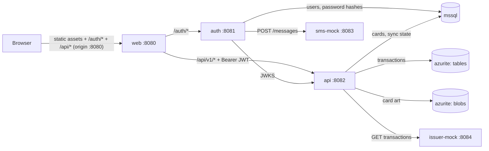
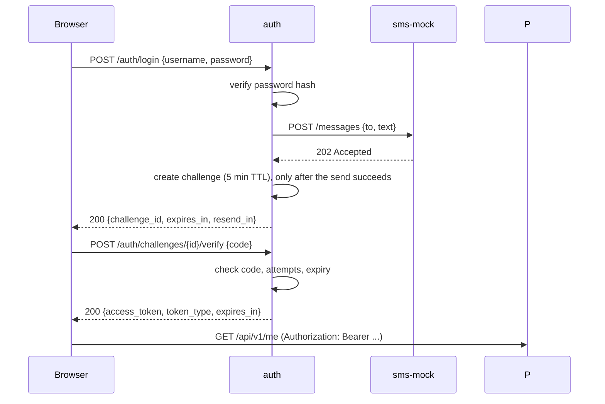

# SME Demo — System Requirements & Architecture

- **Status:** Draft v0.3
- **Owner:** Architecture
- **Last updated:** 2026-11-06
- **Changes in v0.3:** the transaction feed moved to Azure Table Storage via
  Azurite; Cosmos DB deferred behind the same port; licensing notes extracted
  to [`licensing.md`](licensing.md).
- **Changes in v0.2:** ASP.NET Core implementation stack, three-tier layering,
  MediatR/AutoMapper, MSSQL + Cosmos DB + Azure Storage, separate JWT issuer
  container, mock issuer integration.

## 1. Purpose

A demonstration system for a single small/medium business (`sme`) that shows a
card-wallet experience: sign in, see your profile, see your cards, tap a card to
see its transactions.

The system runs entirely offline in Docker on one machine. It is small, but the
boundaries are real: the token issuer is a separate service from the API, tokens
are signed asymmetrically, and the card issuer is an external HTTP dependency
behind an adapter, not a direct database call.

## 2. Goals

| ID | Goal |
|----|------|
| G1 | One command starts the whole demo and it works with no internet access. |
| G2 | Authentication is architecturally separate from the resource API (separate service, separate signing key). |
| G3 | The UI is mobile-first and English-only, and looks like a consumer wallet app (Google Wallet as the reference). |
| G4 | Every demo shortcut is explicit and switchable, so nothing silently becomes production behaviour. |
| G5 | The layering is conventional and boring: thin endpoints, logic in the application layer, data and third-party access in the infrastructure layer. |
| G6 | Swapping the mock issuer or mock SMS provider for a real one is an adapter change, not a rewrite. |

## 3. Non-goals

- Admin roles, user management, registration, password reset, profile editing.
- Multiple organisations or tenants. One deployment serves exactly one
  organisation, configured as `ORG_ID=sme`.
- Real card data. No PAN, no CVV, no real issuer connection. All card and
  transaction data is seeded fiction, produced by a mock issuer.
- Real SMS delivery, real payments, statements, disputes, spend limits.
- Token refresh, revocation lists, device management.
- Production hardening: TLS, WAF, HA, horizontal scaling, full observability
  stack, audit trail.
- Polyglot persistence for its own sake. Each store below has a stated job; if
  it has no job, it does not ship.

## 4. Users and roles

| Role | Count | Description |
|------|-------|-------------|
| Cardholder | 1 | The only account. Signs in, views own profile, cards, and transactions. |

There are no administrators. All users are peers; the demo has exactly one.

## 5. Architecture

### 5.1 Runtime components

| Component | Responsibility | Persistent state | Port |
|-----------|----------------|------------------|------|
| `web` | React SPA, mobile-first wallet UI. Static assets served by nginx. | none | 8080 |
| `auth` | Credential check, OTP challenge, JWT issuance, OIDC-style discovery and JWKS. | MSSQL `sme_auth`, signing keys volume | 8081 |
| `api` | Resource server. Verifies JWTs, serves profile, cards, transactions, card art. | MSSQL `sme_api`, Table + Blob storage | 8082 |
| `issuer-mock` | Stand-in card issuer. Serves card transactions over HTTP. | none (in-memory fixture) | 8084 |
| `sms-mock` | Stand-in SMS provider. Accepts a send request and logs it. | none | 8083 |
| `mssql` | SQL Server 2022. Hosts `sme_auth` and `sme_api`. | `mssql-data` volume | internal 1433 |
| `db-migrator` | One-shot. Applies the API schema script, then exits. | `__EFMigrationsHistory` in `sme_api` | none |
| `db-migrator-auth` | One-shot. Applies the auth schema script, then exits. | `__EFMigrationsHistory` in `sme_auth` | none |
| `db-grants` | One-shot. Creates the two least-privilege application logins. | SQL logins and database users | none |
| `azurite` | Azure Storage emulator. Table for the transaction feed, blob container for card artwork. | `azurite-data` volume | internal 10000, 10002 |

Only `web`, `auth`, `api`, `sms-mock`, and `issuer-mock` publish host ports.
Database and storage containers are reachable only on the Compose network.

### 5.2 Runtime view



The browser never talks to a database, the issuer mock, or the SMS mock, and it
only needs the `web` origin: nginx reverse-proxies `/auth` and `/api` over the
Compose network (requirements §9.8). `api` fetches `auth`'s public keys over the
Compose network and never holds a signing key.

### 5.3 Trust boundaries

- `auth` is the only component that can mint a token.
- `api` trusts a token only after verifying its signature against `auth`'s
  JWKS, plus `iss`, `aud`, and `exp`.
- `org` in the token is checked against the configured `ORG_ID`; it is not on
  its own a permission to see data. Every query is additionally scoped by the
  token's `sub`.
- The issuer mock is untrusted input. Payloads are validated before storage;
  its failures degrade the feed, they do not corrupt the ledger.

### 5.4 Implementation stack

| Concern | Choice |
|---------|--------|
| Runtime | .NET 10 (LTS), C# 14 |
| API host | ASP.NET Core minimal APIs |
| Endpoint orchestration | MediatR (community/free version pinned — see §13.2) |
| Object mapping | AutoMapper (free version pinned — see §13.2) |
| Validation | FluentValidation (Apache-2.0, current stable) + a MediatR pipeline behaviour |
| Persistence (relational) | EF Core 10 + `Microsoft.EntityFrameworkCore.SqlServer` |
| Persistence (transaction feed) | `Azure.Data.Tables` against Azurite |
| Blob storage | `Azure.Storage.Blobs` |
| Outbound HTTP | `IHttpClientFactory` (`Microsoft.Extensions.Http`); bounded startup retries live in `IssuerSyncService` |
| Authentication | `Microsoft.AspNetCore.Authentication.JwtBearer` |
| Token creation | `Microsoft.IdentityModel.JsonWebTokens` |
| Password hashing | `Microsoft.AspNetCore.Identity.PasswordHasher<T>` (PBKDF2) |
| OpenAPI | built-in `Microsoft.AspNetCore.OpenApi` |
| Errors | built-in `ProblemDetails` + `IExceptionHandler` |
| Health checks | `Microsoft.Extensions.Diagnostics.HealthChecks` |
| Logging | built-in `Microsoft.Extensions.Logging`, JSON console |

**Preference rule.** Microsoft packages come first for runtime, hosting,
authentication, data access, and outbound HTTP. A well-maintained OSS library is
acceptable when it is licence-clean and has no real first-party equivalent:
FluentValidation qualifies (Apache-2.0), as do MediatR and AutoMapper in their
last permissively-licensed versions (§13.2). Packages that duplicate a
first-party capability without adding much stay out: Serilog (built-in logging),
Swashbuckle (built-in OpenAPI), Dapper (EF Core), Mapster (AutoMapper),
MassTransit (not needed at this size).

### 5.5 Layering rules

Three tiers plus a domain project, all in one solution:

```
src/
  SmeDemo.Api/              presentation: endpoints, auth wiring, composition root
  SmeDemo.Application/      use cases: MediatR handlers, DTOs, profiles, port interfaces
  SmeDemo.Domain/           entities, value objects, domain errors
  SmeDemo.Infrastructure/   adapters: EF Core, Table Storage, Blob, issuer HTTP client
  SmeDemo.Auth/             independent JWT issuer service, own project and Dockerfile
tests/
  SmeDemo.Application.Tests/
  SmeDemo.Api.Tests/        integration through WebApplicationFactory
```

The rules that make "thin endpoints" mean something:

| Rule | Enforcement |
|------|-------------|
| An endpoint may only bind input, call `ISender.Send`, and map the result to HTTP. | Code review; endpoints inject application ports, never storage clients. |
| No `DbContext`, `TableClient`, `BlobClient`, or `HttpClient` in `Api` endpoint files. | Only `Program.cs` and the `AddInfrastructure` extension may reference them; everything else resolves interfaces declared in `Application`. |
| No business rules in handlers that belong to entities. | Domain project owns invariants; handlers orchestrate. |
| Every third-party dependency is behind an interface declared in `Application`. | Adapters live in `Infrastructure` and are registered in the composition root. |
| Cross-cutting concerns are pipeline behaviours, not repeated code. | Logging, validation, and timing behaviours in `Application`. |

**Where validation lives.** Request shape — required fields, formats, ranges,
page sizes, 6-digit OTP codes — is enforced by FluentValidation validators in
`Application`, run by a pipeline behaviour before the handler. Business
invariants — a card belongs to the caller, an amount is positive, a status
transition is legal — stay in `Domain`. Validators never touch the database: a
check that needs a lookup is a business decision, and belongs in the handler
where it can also return the right error code.

Typical request path: endpoint → `ISender.Send(GetCardTransactionsQuery)` →
validation behaviour → handler → `ITransactionStore` / `ICardRepository` →
DTO mapped by AutoMapper → `Results.Ok` or a `ProblemDetails` result.

### 5.6 Container and resource footprint

Ten containers, three of which run once (the two migrators and `db-grants`).
Approximate steady-state memory:

| Container | Memory | Notes |
|-----------|--------|-------|
| `mssql` | ~2 GB | SQL Server 2022 Developer image. |
| `azurite` | ~250 MB | Blob and table endpoints. |
| `web` | ~50 MB | nginx + static assets. |
| `auth` | ~200 MB | |
| `api` | ~250 MB | |
| `issuer-mock` | ~150 MB | |
| `sms-mock` | ~150 MB | |
| `db-migrator`, `db-migrator-auth`, `db-grants` | one-shot | Apply the schema and create the application logins, then exit. |
| **Total** | **~3 GB** | Docker Desktop memory of 4 GB is enough; 8 GB is comfortable. |

The MSSQL container dominates this. The Cosmos emulator was the real cost, and
dropping it is what keeps the demo runnable on an ordinary laptop (see §8.6).

## 6. Authentication

### 6.1 Flow



### 6.2 Endpoints (auth)

| Method | Path | Purpose |
|--------|------|---------|
| POST | `/auth/login` | Verify username/password, send the SMS, create the MFA challenge only when the send succeeds. |
| POST | `/auth/challenges/{challenge_id}/verify` | Verify OTP, return access token. |
| POST | `/auth/challenges/{challenge_id}/resend` | Re-send OTP, subject to cooldown. |
| GET | `/auth/userinfo` | Bearer-protected profile (`id`, `name`, `phone`, `org`) read from `auth.users`; the token is verified locally against the current and previous signing keys. |
| GET | `/.well-known/openid-configuration` | Issuer metadata (`issuer`, `jwks_uri`). |
| GET | `/.well-known/jwks.json` | Public signing keys. |
| GET | `/healthz` | Liveness for Compose. |

The discovery document exists so the API can use the stock `JwtBearer` handler
with `MetadataAddress`, instead of hand-rolled validation code.

### 6.3 Challenge rules

| Rule | Value |
|------|-------|
| Challenge TTL | 5 minutes |
| Max verification attempts | 3, then the challenge is destroyed |
| Resend cooldown | 60 seconds |
| Challenge reuse | Single use; a successful verify invalidates it |
| Challenge storage | In-memory in `auth` (single instance, demo only) |

Codes and challenges are never logged in plaintext by the API or the UI.

### 6.4 Demo mode

`DEMO_MODE=true` makes the following true:

- The only accepted username, password, and phone number come from environment
  variables (`DEMO_USERNAME`, `DEMO_PASSWORD`, `DEMO_PHONE`).
- The OTP is the fixed value `DEMO_OTP` (default `123456`) instead of a random
  code.
- The login screen shows a clearly labelled demo hint with the credentials.

With `DEMO_MODE=false`, the fixed OTP path is refused at startup and a real
`ISmsProvider` must be configured. This prevents the fixed code from ever
becoming a back door.

Demo mode changes which code is sent, not whether a message is sent: the fixed
`DEMO_OTP` is still delivered through the configured provider, so it appears in
`sms-mock`'s log like any other code.

### 6.5 SMS provider seam

`auth` depends on:

```
ISmsProvider.Send(phoneNumber, message, cancellationToken) -> providerMessageId
```

The demo implementation posts to `SMS_PROVIDER_URL` (`http://sms-mock:8083` in
Compose). Replacing it with Twilio, SNS, or an internal gateway means one adapter
plus one environment variable.

`POST /messages` accepts `{ "to": "<phone>", "text": "<message>" }`
(`Content-Type: application/json`). It validates only the envelope: `to` is
required and 1–32 characters after trimming, `text` is required and 1–1600
characters after trimming. A valid message returns `202 Accepted` with a
`text/plain` provider message id shaped `sms-<32 lowercase hex>`. Invalid input
returns `400` with the usual `VALIDATION_ERROR` envelope and the offending field
under `errors` (`to`, `text`, or `body` when the JSON cannot be read).

The mock logs every accepted message in plain text
(`SMS to <phone>: <text>`). That is deliberate: the demo OTP has to be readable
in `docker compose logs sms-mock`. Rejected requests are not logged, and the
caller IP is not recorded. Unlike the rest of the system, this demo-only service
does deliberately record the recipient phone number and message text, including
the OTP; it has no other delivery mechanism. The request body is capped at 64 KB.

When the gateway is unreachable, times out, or returns a non-2xx status, login
and resend return `503` with code `UPSTREAM_UNAVAILABLE` and the message
"The SMS provider is unavailable. Try again shortly." A login that fails this way
does not leave a challenge behind; a failed resend keeps the already-updated
challenge, so the user waits out the 60 second cooldown. Caller cancellation is
never translated into a 503.

### 6.6 Token specification

- Format: JWT, **RS256**, 2048-bit RSA, `kid` in the header.
- Issuer metadata and JWKS are published by `auth`; keys are generated on first
  start and persisted in the `auth-keys` volume.

| Claim | Example | Notes |
|-------|---------|-------|
| `iss` | `http://auth:8081` | Must equal `JWT_ISSUER`. |
| `aud` | `sme-demo-api` | Must equal `JWT_AUDIENCE`. |
| `sub` | `7f3c...` | User ID. The only identifier used for data lookups. |
| `org` | `sme` | Organisation code. Must equal the API's `ORG_ID`. |
| `name` | `Alex Morgan` | Display convenience only. |
| `iat` / `exp` | — | TTL 30 minutes (`JWT_TTL`). |
| `jti` | UUID | Unique token ID, logged for traceability. |

Deliberate omissions:

- **No phone number in the token.** It is PII, it would end up in logs and
  browser storage, and the API can read it from the database anyway.
- **No roles or permissions.** With one peer-level user there is nothing to
  express; adding a role model now would be speculative.

Accepted limitations: no refresh token, no revocation.

### 6.7 Issuer implementation notes

- `auth` is a separate project (`SmeDemo.Auth`) with its own Dockerfile and its
  own database (`sme_auth`) on the shared MSSQL instance. It shares no domain
  code with `api`.
- Password hashes use `PasswordHasher<User>` (PBKDF2-HMAC-SHA256, per-user
  salt). Even the single demo account is stored hashed.
- The signing key is generated on first start, written to `/keys` on the
  `auth-keys` volume, and never committed.
- `api` configures `JwtBearer` with `MetadataAddress =
  http://auth:8081/.well-known/openid-configuration` and
  `RequireHttpsMetadata = false`. That flag is development-only and must be
  tied to configuration, not hard-coded.

## 7. Resource API

Base path `/api/v1`. JSON only. `Authorization: Bearer <jwt>` on every request
except `/healthz`.

| Method | Path | Purpose |
|--------|------|---------|
| GET | `/api/v1/me` | Profile: id, name, org from the token; phone comes from `/auth/userinfo`. |
| GET | `/api/v1/me/cards` | All cards for the caller, in display order. |
| GET | `/api/v1/me/cards/{card_id}/transactions` | Transactions for one card, newest first. |
| GET | `/api/v1/cards/{card_id}/art` | Card artwork, streamed from blob storage. |
| GET | `/healthz` | Liveness for Compose. |
| GET | `/openapi/v1.json` | OpenAPI document (Development only). |

### 7.1 Responses

- `GET /me` → `{ "id", "name", "org" }`, taken from the verified token. It
  deliberately carries no phone number: the profile screen reads that from
  `GET /auth/userinfo`, so PII does not travel in the token or its response.
- `GET /me/cards` → `{ "items": [ { "id", "brand", "last4", "expiry_month",
  "expiry_year", "status", "currency", "display_order", "art_url" } ] }`.
- Transactions → `{ "items": [ { "id", "card_id", "amount_minor", "currency",
  "direction", "merchant", "status", "occurred_at" } ], "next_cursor": "..." }`.

The UI never constructs storage URLs; `art_url` always points back at the API,
so blob credentials never reach the browser.

### 7.2 Errors

```json
{ "error": { "code": "TOKEN_EXPIRED", "message": "Access token has expired." } }
```

Validation failures additionally carry a per-field dictionary:

```json
{ "error": { "code": "VALIDATION_ERROR",
             "message": "One or more validation errors occurred.",
             "errors": { "code": ["The code must be 6 digits."] } } }
```

| Code | HTTP | When |
|------|------|------|
| `VALIDATION_ERROR` | 400 | Malformed body or query, or a validator rejected the request; details in `error.errors`. |
| `UNAUTHENTICATED` | 401 | Missing or unparseable bearer token. |
| `TOKEN_EXPIRED` | 401 | `exp` in the past. |
| `INVALID_TOKEN` | 401 | Signature, `iss`, or `aud` mismatch. |
| `FORBIDDEN` | 403 | Token valid but org mismatch or resource not owned. |
| `NOT_FOUND` | 404 | Unknown card ID. |
| `UPSTREAM_UNAVAILABLE` | 503 | A required store is unavailable after retries. |
| `RATE_LIMITED` | 429 | Too many OTP attempts or sends. |
| `INTERNAL` | 500 | Unhandled failure. |

### 7.3 Pagination

Cursor-based, `limit` default 20, maximum 100. The cursor is the store's row key,
base64url-wrapped, so the contract does not leak the storage layout and the
client never constructs one. `next_cursor` is `null` on the last page. No total
counts.

## 8. Data model

### 8.1 Store ownership

| Store | Owns | Why |
|-------|------|-----|
| MSSQL `sme_auth` | users, password hashes | Relational, transactional, written only by `auth`. |
| MSSQL `sme_api` | cards, issuer sync state | Small, relational, joined on demand. |
| Table `transactions` | the transaction feed | Append-only, per-card, ordered by row key. |
| Blob `card-art` | card artwork images | Binary assets, not queryable. |

There is no dual write. Each fact has exactly one home, and only `api` reads
more than one store.

### 8.2 `auth.users` (MSSQL `sme_auth`)

| Column | Type | Notes |
|--------|------|-------|
| `id` | uniqueidentifier, PK | Becomes `sub`. |
| `org_id` | nvarchar(32) | `sme`. |
| `username` | nvarchar(128), unique | Demo value from env. |
| `password_hash` | nvarchar(256) | PBKDF2, never plaintext. |
| `name` | nvarchar(128) | Display name. |
| `phone` | nvarchar(32) | E.164. MFA destination. |
| `status` | nvarchar(16) | `active` / `disabled`. |
| `created_at` | datetime2 | UTC. |

### 8.3 `app.cards` (MSSQL `sme_api`)

| Column | Type | Notes |
|--------|------|-------|
| `id` | uniqueidentifier, PK | |
| `user_id` | uniqueidentifier | Logical reference to `auth.users.id`; no cross-database FK. |
| `org_id` | nvarchar(32) | `sme`. |
| `brand` | nvarchar(32) | `visa`, `mastercard`. |
| `last4` | char(4) | **Only the last four digits are ever stored.** |
| `expiry_month` | tinyint | 1–12. |
| `expiry_year` | smallint | Four digits. |
| `status` | nvarchar(16) | `active`, `frozen`, `expired`. |
| `currency` | char(3) | ISO 4217, `AUD`. |
| `display_order` | smallint | Wallet ordering. |
| `art_blob_name` | nvarchar(128) | Blob name for the card artwork. |

### 8.4 `app.issuer_sync` (MSSQL `sme_api`)

| Column | Type | Notes |
|--------|------|-------|
| `card_id` | uniqueidentifier, PK | |
| `last_synced_at` | datetime2 | UTC. |
| `last_status` | nvarchar(16) | `ok` / `failed`. |
| `last_error` | nvarchar(512), null | Redacted message. |

This is the only table that records integration state, and it is what makes the
issuer dependency visible rather than implicit. `last_synced_at` is the time of
the last attempt, successful or not; `last_status` says which it was.

### 8.5 `transactions` (Table Storage)

One table, `transactions`. Table Storage has no secondary indexes and no
cross-partition ordering, so the key design carries the query:

| Key | Value | Why |
|-----|-------|-----|
| `PartitionKey` | card ID | Every read is scoped to one card. |
| `RowKey` | `{reverseTicks:D19}_{transactionId}` | Ascending order on a zero-padded reversed tick count equals newest-first; the ID breaks ties. |

`reverseTicks = DateTime.MaxValue.Ticks - occurredAt.UtcTicks`, formatted to 19
digits. A page is a range scan:

```
PartitionKey eq '{cardId}' and RowKey gt '{cursor}'
```

The cursor is the last returned `RowKey`, so pagination stays stable even when
new transactions arrive between requests.

Entity fields: `OrgId`, `TransactionId`, `AmountMinor`, `Currency`, `Direction`,
`Merchant`, `Status`, `OccurredAt`, `PostedAt`, `IssuerPayload` (string, the raw
issuer JSON), `IngestedAt`. Entities are upserted by `RowKey`, so re-syncing the
same transaction is idempotent.

`PostedAt` and `IssuerPayload` are written from the issuer response by
`IssuerSyncService`; `IssuerPayload` is the exact JSON object for that
transaction. A row written by an older release may not have them, so the store
reads `PostedAt` as `OccurredAt` and `IssuerPayload` as `{}` when absent.

Known limits, accepted because the feed only ever does one thing: no
cross-partition queries, no server-side aggregation, and 1 MB per entity. The
issuer payload must stay under that limit; at a few KB per transaction it does.

### 8.6 Transaction store abstraction

`Application` declares `ITransactionStore` with one read method (card, cursor,
limit) and one write method (upsert batch). The only adapter in this version is
`TableTransactionStore`.

Cosmos DB is deliberately **not** implemented. Nothing in this document needs a
document database: the feed is per-card, append-only, and small. A
`CosmosTransactionStore` can be added later without touching the application
layer, because the port already exists. The trigger is a real requirement —
multi-region reads, entities above 1 MB, rich querying, sustained write volume —
not the wish to have a document database in the diagram.

Cost note for that eventual decision: Cosmos DB bills by provisioned throughput
or request units, and a provisioned container has a floor that is billed
continuously even when idle. At demo volume (tens of rows, one user) that floor
is the entire bill. Table Storage bills per stored GB and per request, which
rounds to zero here.

### 8.7 Seed and sync

1. `auth` seeds one user (from env values); in demo mode an existing account is
   kept in step with `DEMO_USERNAME` / `DEMO_PASSWORD` / `DEMO_PHONE` and
   `ORG_ID` instead of being left stale.
2. `api` seeds three cards and their artwork (uploaded to `card-art`) if empty.
   `SEED_ENABLED=false` skips this step.
3. `IssuerSyncService` pulls each card's transactions from `issuer-mock` at
   start-up and every `ISSUER_SYNC_INTERVAL` (default 5 minutes), validates the
   payload, and upserts it into Table Storage by row key. No transactions are
   seeded by the API itself.
4. A failed pull is recorded as `failed` in `app.issuer_sync` with a bounded,
   redacted message, and the next card is attempted. The API stays healthy and
   keeps serving the last good local feed; an issuer outage never turns a
   transaction request into a 500.
5. The issuer fixture is deterministic, so a reset always produces the same
   three cards and 40 transactions, with identical IDs, timestamps, amounts,
   directions, merchants, and statuses.

The UI therefore reads a warm, local feed and never waits on the issuer.

### 8.8 Schema evolution

Schema change is the most dangerous routine operation in a system like this, so
it gets rules rather than habits.

**Ownership first.** Each database is migrated only by the service that owns it:
`auth` owns `sme_auth`, `api` owns `sme_api`. No migration touches another
service's tables, and there are no cross-database foreign keys. A release of one
service therefore never requires a coordinated change in the other. This is the
single largest stability property in the design.

**Migrations are code, applied as reviewable SQL.**

- The schema is defined by EF Core migrations: one migration per logical change,
  committed next to the entity change that caused it.
- A migration reaches a database only through the **idempotent SQL script**
  generated from it (`dotnet ef migrations script --idempotent`), never through
  `Database.Migrate()` at application start-up.
- Those scripts are committed artefacts (`db/migrations/api/sme_api.sql` today;
  the auth service brings its own directory) and baked into the `db-migrator`
  image. Reviewers read SQL, not C# builder calls.
- `db-migrator` runs once per `docker compose up`, before `auth` and `api`, and
  exits. If it fails, nothing else starts.

Migrating at start-up is rejected for four reasons: replicas race each other, a
failed migration leaves a half-running app, the timing of the change is
invisible to whoever is operating the system, and the application would need DDL
rights it should not have. None of those problems is worth the convenience, even
in a demo.

**Rules that make a change safe.**

| Rule | Why |
|------|-----|
| Migrations are append-only. An applied migration is never edited. | Editing history means two checkouts produce two schemas. |
| Every change must be compatible with the previous release. | Old and new code overlap during a rolling deploy. |
| Destructive changes ship in a later release than the code that stops using the column. | Dropping something still being read breaks the version still running. |
| Backfills are separate from schema changes, batched, and restartable. | A long backfill inside a DDL transaction locks the table and cannot resume. |
| Scripts are idempotent, with `IF NOT EXISTS` guards and the migration history table. | Re-running against a partially migrated database must be safe. |
| `EnsureCreated()` is forbidden outside unit tests. | It bypasses migration history and forks the schema. |

**Expand, then contract.** For anything non-trivial the sequence is: expand the
schema so both code versions work, deploy code that writes both shapes, backfill,
switch reads, and contract in a later release.

| Change | Safe sequence |
|--------|---------------|
| Add a nullable column | One migration; old code ignores it. |
| Add a NOT NULL column | Add nullable → backfill → add default and NOT NULL in a later migration. |
| Rename a column | Add new → dual-write → backfill → switch reads → drop old, over three releases. |
| Change a column type | Add new column → backfill → dual-write → switch → drop old. |
| Drop a column or table | Stop reading it in release N, drop it in release N+1. |
| Add a table or index | Straightforward; table sizes here make it instant. |

At demo scale most of these collapse to a single step. The sequence is written
down because the first real table will not be demo-sized.

**What is verified before merge.**

1. `dotnet ef migrations has-pending-model-changes` fails the build when an
   entity changed without a matching migration.
2. The scripts are applied to a **fresh** database and to a database restored
   from the **previous release's schema**. The upgrade path matters more than
   the empty path, and it is the one that is usually skipped.
3. Integration tests run against the upgraded database.
4. The generated script is scanned for `DROP`, `ALTER COLUMN`, and `DELETE`;
   those pull in a second reviewer and a written reason.

**Rollback policy.** Roll forward; do not roll back. `Down()` is written only for
changes that are genuinely reversible, and destructive migrations have no down
path — they rely on a backup taken beforehand and verified. In the demo,
"rollback" is `docker compose down -v && docker compose up`, which is exact
because all data is seeded.

**Privileges.**

| Principal | Rights | Used by |
|-----------|--------|---------|
| `sa` | full | Local container bootstrap only; never in an application connection string. |
| `sme_migrator` | `db_owner` on both databases | `db-migrator` only. |
| `sme_auth_app` | `db_datareader`, `db_datawriter` on `sme_auth` | `auth` |
| `sme_api_app` | `db_datareader`, `db_datawriter` on `sme_api` | `api` |

The application logins cannot create, alter, or drop anything. If the API is
compromised, the blast radius is rows, not schema — and that is the difference
between an incident and a very bad day.

In the local Compose setup the two one-shot migrators still authenticate as
`sa`, the container bootstrap identity. A dedicated `sme_migrator` login with
`db_owner` on both databases is the deployment target, not part of the demo.

### 8.9 Delivery pipeline shape

The local `db-migrator` is a stand-in for what larger organisations run as a
dedicated database pipeline. It is the same idea at two scales, and the pattern
is worth naming.

**Two families of schema tooling.**

| Family | How it works | Examples |
|--------|--------------|----------|
| Migration-based (imperative) | Ordered, append-only change scripts applied in sequence; a ledger records what ran. | EF Core migrations, Flyway, Liquibase changelogs, DbUp |
| State-based (declarative) | The desired schema is declared; the tool diffs it against the target and generates the change. | SSDT `.sqlproj` + DACPAC, Redgate SQL Compare |

A "schema project" in a Microsoft shop is usually the state-based kind: a
`.sqlproj` committed like code, built into a DACPAC, and published by a
pipeline. That works well when the database is the primary artefact and several
applications share it. It is a poor fit here, because EF Core already owns the
model — keeping a `.sqlproj` beside it creates two sources of truth, and the
drift between them surfaces at the worst possible moment.

**What we adopt from the large-organisation pattern.**

| Practice | Here |
|----------|------|
| Schema changes go through pull request, never ad-hoc access | Migrations are reviewed together with their generated SQL. |
| A dedicated pipeline builds and applies the change, separate from the application deploy | The pipeline builds the migrator image and runs it; application deploys never carry DDL. |
| The artefact is versioned and immutable | The migrator image is tagged per commit; the SQL scripts inside it are the reviewed artefact. |
| Apply to a disposable database first, then to the target | Fresh database, plus an upgrade from the previous schema, in CI. |
| The identity applying changes is not the identity serving traffic | Migrator login has `db_owner`; application logins do not. |

**What we leave out, deliberately.** Multi-environment promotion
(dev → staging → prod) with manual DBA gates, drift detection against
production, and a separate schema repository. Each exists to coordinate many
teams and many databases. One demo and one database do not need them, and the
ceremony would hide the parts that matter.

**If the demo grows up.** The artefact is plain SQL, so the runner can be
swapped for Flyway or Liquibase without touching the application. What must be
kept is the boundary: the app never applies schema changes, and every change has
a reviewed script with a recorded version.

### 8.10 Issuer API contract

`issuer-mock` is a stand-in for the card issuer. The API talks to it only
through `IIssuerClient`; swapping in a real issuer means replacing the adapter,
not the sync logic or the read path.

| Method | Path | Auth | Response |
|--------|------|------|----------|
| GET | `/healthz` | none | `{ "status": "ok" }` |
| GET | `/issuer/v1/cards/{card_id}/transactions` | `X-Api-Key: <ISSUER_API_KEY>` | `{ "card_id", "transactions": [...] }` |

Each transaction object is:

```json
{
  "transaction_id": "00000000-0000-4000-8000-000000000001",
  "amount_minor": 450,
  "currency": "AUD",
  "direction": "debit",
  "merchant": "Dan Murphy's",
  "status": "posted",
  "occurred_at": "2026-10-31T21:00:00Z",
  "posted_at": "2026-10-31T23:00:00Z"
}
```

Transactions are returned newest first. Errors use
`{ "error": { "code", "message" } }`: a missing or wrong API key is `401`
`UNAUTHORIZED`, and an unknown card is `404` `CARD_NOT_FOUND`.

In the fixture, `posted_at` is always `occurred_at + 2 hours`, including pending
transactions; that rule is part of the fixture contract.

The payload is untrusted. `IssuerSyncService` rejects the whole card when
`card_id` does not match the request, `transaction_id` is empty, `currency` is
not three characters, `direction` is not `debit`/`credit`, `status` is not
`posted`/`pending`, `amount_minor` is not positive, the merchant is empty, a
timestamp is missing, or the card returns more than 500 transactions. Nothing
from that card is written until every record has passed.

The fixture lives in `tools/IssuerMock/fixtures/transactions.json` and is part of
the demo contract (see §13.4).

## 9. Front-end

### 9.1 Stack

React 18 + TypeScript + Vite + React Router + Tailwind CSS, built to static
assets and served by nginx. This matches the production stack, so the demo UI is
disposable but not alien.

### 9.2 Routes

| Route | Screen | Notes |
|-------|--------|-------|
| `/login` | Sign-in | Username, password, then OTP step. Demo hint visible in demo mode. |
| `/wallet` | Card wallet | Grid of card tiles. Default route after sign-in. |
| `/wallet/cards/:cardId` | Card detail | Card summary plus its transactions. |
| `/profile` | Profile | Name and organisation from `/me`; phone from `/auth/userinfo`. |

### 9.3 Wallet experience

- Cards render as rounded rectangles at roughly 1.586:1, in a responsive grid:
  one column at 360 px, two at 640 px, three at 1024 px, capped at a comfortable
  max width.
- Each tile shows brand, masked number (`•••• 4242`), expiry, and status.
- Tapping a tile navigates to that card's transactions; back returns to the
  wallet without losing scroll position.
- Visual tone: brand-coloured gradients, generous spacing, large tap targets
  (minimum 44 px), no dense tables.

### 9.4 Transactions screen

- Card summary at the top, then transactions newest first, grouped by date. The
  order is exactly the API's order; grouping never re-sorts rows.
- The list requests 10 rows per page (`limit=10`) and appends the next page with
  `next_cursor`. The seeded feed holds 14, 13, and 13 transactions per card, so
  every card has a second page and "Load more" is demonstrable. Appended rows are
  de-duplicated by transaction `id`; when `next_cursor` is null the action is
  removed.
- Each row: merchant, time, signed amount (`-A$12.40` / `+A$5.00`), and a
  `Pending` badge when applicable. Posted rows have no badge.
- "Load more" failed: rows already on screen stay, a readable error appears at
  the bottom, and retrying repeats the same cursor rather than resetting to the
  first page. A failed first page shows an error with a retry action instead.
- Empty state: "No transactions yet."

### 9.5 States

Every screen handles: loading (skeleton, not a spinner-only blank), empty,
request failure with retry, and expired session. On the card screen this means a
skeleton for the card summary and another for the transaction rows, an empty
transactions message, a first-page error with retry, a load-more error that keeps
the loaded rows, and no page-level error for a 401 (the request layer redirects).

### 9.6 Session handling

- The token is held in `sessionStorage` and attached by a single fetch wrapper.
- A `401` on an authenticated request clears the token and redirects to `/login`
  with a short message. The sign-in, verify, and resend calls are made without
  the token, so their `401` is a form error and never triggers that redirect.
- No silent refresh; expiry after 30 minutes returns the user to sign-in.

### 9.7 Localisation

English only, `en-AU` formatting: `A$` currency symbol, `DD MMM YYYY` dates.
Card expiry is the industry `MM/YY` form (`09/28`), not a full date.

### 9.8 Implementation choices

- **One origin.** The browser only talks to `http://localhost:8080`. nginx serves
  the built SPA and reverse-proxies `/auth/*` to `auth:8081` and `/api/*` to
  `api:8082`, preserving the original path. Vite's dev server proxies the same
  paths to `localhost:8081`/`8082`, so application code always uses same-origin
  relative paths; there is no base-URL configuration and no browser CORS.
- **Card artwork uses a blob URL.** `art_url` is absolute, but the browser calls
  its pathname + query through the same origin with the bearer token, because an
  `` cannot send an `Authorization` header. The response is converted
  to a blob object URL, cached per session, and revoked on sign-out or unload. A
  failed artwork request falls back to a brand-coloured gradient tile with text.
- **Local time for grouping.** Transactions are grouped by calendar date in the
  browser's local time zone, not UTC, so a late-evening transaction stays on the
  day the user saw it. Amounts use `Intl.NumberFormat` with `en-AU` (A$), dates
  `DD MMM YYYY`, and times `HH:mm`.
- **Paged transactions.** The card screen asks for `limit=10` and follows
  `next_cursor`; the list is never cached across visits, so re-entering a card
  starts from the first page again. Appends are de-duplicated by id in the
  client. The wallet's scroll offset is kept in `sessionStorage`
  (`sme.wallet.scroll`) only, restored once after the grid renders, and cleared
  on sign-out or session expiry; it is never written to `localStorage`.
- **401 semantics.** A 401 on an authenticated request clears `sessionStorage`,
  revokes cached artwork, and redirects to `/login?reason=expired`. The login,
  verify, and resend calls use the wrapper with `auth: false`; there a 401 is a
  form error and never clears the session or redirects.
- **Demo hint source.** The `/login` demo panel is rendered from `/config.js`,
  which the `web` container generates at start-up from `DEMO_MODE`,
  `DEMO_USERNAME`, `DEMO_PASSWORD`, and `DEMO_OTP`. With `DEMO_MODE=false` the
  file contains no credentials and the hint is not shown.
- **Token storage.** The access token lives in `sessionStorage` only. There is no
  `localStorage`, no refresh token, and no token in a URL or log.

## 10. Docker and runtime

### 10.1 Compose services

| Service | Image | Published | Healthcheck |
|---------|-------|-----------|-------------|
| `web` | multi-stage Node build → nginx | 8080 | `GET /` |
| `auth` | built from `src/SmeDemo.Auth` | 8081 | `GET /healthz` |
| `api` | built from `src/SmeDemo.Api` | 8082 | `GET /healthz` |
| `sms-mock` | built from `tools/SmsMock` | 8083 | `GET /healthz` |
| `issuer-mock` | built from `tools/IssuerMock` | 8084 | `GET /healthz` |
| `mssql` | `mcr.microsoft.com/mssql/server:2022-latest` | none | `sqlcmd SELECT 1` |
| `db-migrator` | built from `tools/Migrator` | none | exits 0 |
| `db-migrator-auth` | built from `tools/Migrator` | none | exits 0 |
| `db-grants` | `mcr.microsoft.com/mssql/server:2022-latest` | none | exits 0 |
| `azurite` | `mcr.microsoft.com/azure-storage/azurite` | none | blob and table probes |

Startup ordering: `mssql` healthy → `db-migrator` and `db-migrator-auth` complete
→ `db-grants` completes → `auth` → `api`;
`api` also waits for `azurite` and for `issuer-mock` to start. `web` starts only
after both `auth` and `api` are healthy, and its healthcheck requests `/`, which
proves that nginx is serving the built shell; the reverse proxy itself is
exercised by the app and by acceptance 18, not by the healthcheck. `auth` waits
for `sms-mock` to start but not for it to become healthy:
a broken SMS mock must not stop `auth` from starting, because login has to return
a readable 503 instead (acceptance 17). The issuer dependency is deliberately not
a health gate either: the sync worker records a failure and the API serves its
local feed, so a broken issuer cannot stop the API from starting. `issuer-mock`
is reachable only on the Compose network for `api`; the local `8084` mapping
exists for debugging and the documented curl examples. Every published port
binds to `127.0.0.1`: the demo credential and OTP are part of the documentation,
so the stack must not be reachable from another machine.

### 10.2 Compose profiles

One profile: everything. There is no lite mode, because the only component that
justified one — the Cosmos emulator — is no longer in the stack.

If Cosmos is added later (§8.6), it arrives as an optional profile plus a second
`ITransactionStore` adapter, not as a change to the default path.

### 10.3 Configuration

| Variable | Used by | Default |
|----------|---------|---------|
| `ORG_ID` | auth, api | `sme` |
| `DEMO_MODE` | auth, web | `true` |
| `DEMO_USERNAME` / `DEMO_PASSWORD` | auth, web | demo values; web publishes them only as the `/login` hint |
| `DEMO_PHONE` | auth | demo value |
| `DEMO_OTP` | auth, web | `123456`; web publishes it only as the `/login` hint |
| `JWT_ISSUER` / `JWT_AUDIENCE` / `JWT_TTL` | auth, api | `http://auth:8081`, `sme-demo-api`, `30m` |
| `AUTH_METADATA_URL` | api | `http://auth:8081/.well-known/openid-configuration` |
| `SMS_PROVIDER_URL` | auth | `http://sms-mock:8083` |
| `ISSUER_BASE_URL` / `ISSUER_API_KEY` | api | `http://issuer-mock:8084`, `demo-issuer-key` |
| `ISSUER_SYNC_INTERVAL` | api | `5m` (short forms such as `10s` are accepted) |
| `ISSUER_SYNC_ENABLED` | api | `true`; `false` does not register the sync worker |
| `AZURE_STORAGE_CONNECTION_STRING` | api | `UseDevelopmentStorage=true` outside Docker; Compose sets explicit `BlobEndpoint`/`TableEndpoint` values |
| `TRANSACTIONS_TABLE` / `CARD_ART_CONTAINER` | api | `transactions`, `card-art` |
| `AUTH_REQUIRE_HTTPS_METADATA` | api | `true`; Compose sets `false` because auth is plain HTTP on its internal port |
| `PUBLIC_BASE_URL` | api | `http://localhost:8082` |
| `SEED_ENABLED` | api | `true` |
| `DATABASE_URL` (auth/api) | auth, api | Compose-internal DSNs using the app logins |
| `SME_API_DB_PASSWORD` / `SME_AUTH_DB_PASSWORD` | db-grants, api, auth | `.env` only; grants add `db_datareader` + `db_datawriter` |
| `CORS_ORIGIN` | auth, api | `http://localhost:8080` |

Secrets live in `.env` (git-ignored, with `.env.example` committed). No secret
is baked into an image.

### 10.4 Start, seed, reset

- `docker compose up --build` builds and starts everything.
- `db-migrator` applies the idempotent schema scripts, then exits; `auth` and
  `api` start only after it succeeds.
- Seed data is applied idempotently at start-up (one user, three cards and their
  artwork); the API then pulls about 40 transactions from `issuer-mock` and
  upserts them into Table Storage.
- `docker compose down -v && docker compose up` returns the demo to its initial
  state, including the same 40 transaction IDs from the deterministic fixture.

### 10.5 Offline behaviour

Images are pulled and NuGet/npm dependencies restored once during
`docker compose build`, when a network is available. The `web` image runs
`npm ci` inside its Node build stage and copies only the built assets into the
nginx runtime stage. After that the demo runs with no outbound traffic: no
external SMS, no CDN assets, no remote fonts, and no runtime npm access.

### 10.6 Deployment configuration

Build and deploy are separate concerns with separate artefacts:

| Stage | Output | Lives in |
|-------|--------|----------|
| Build | container images tagged by commit SHA | image registry |
| Configure | per-environment values: image tag, ports, replicas, secret references | a deployment repository |
| Deploy | a commit that changes the image tag | the same deployment repository |

Rules:

- Images are immutable and tagged by commit SHA; `latest` is never deployed.
- Deployment configuration is code, reviewed like code, and lives in its own
  repository whose write access is restricted to release owners (CODEOWNERS
  plus branch protection). Developers change the application; release owners
  change what runs, and where.
- A deploy is a commit, and a rollback is a revert of that commit. That is the
  "every change is traceable, nothing is done by hand" property.
- Secrets are never stored in the deployment repository; it references a secret
  store or, in the demo, an uncommitted `.env` file.
- Kubernetes manifests or Helm values are the usual shape of that repository at
  scale. They are out of scope here, because there is no cluster to deploy to.

For this demo, `docker-compose.yml` in this repository is the entire deployment. When
the demo earns a server, the split applies unchanged: a small
`sme-demo-deploy` repository holding the compose file or Helm values, and a
pipeline that applies it on merge.


Implemented:

- Passwords hashed with PBKDF2 (ASP.NET Core Identity hasher), even for the one
  demo account.
- RS256 tokens, 30-minute TTL, signature and `iss`/`aud`/`exp` all validated.
- The fixed OTP is unreachable unless `DEMO_MODE=true`.
- CORS allowlist limited to the web origin.
- No PAN, CVV, or PIN anywhere in code, seed data, or logs.
- Card art served only through the API; storage credentials stay server-side.
- Application logs redact phone numbers and tokens. The demo-only `sms-mock`
  deliberately records the recipient and message text (including the OTP); that
  is its delivery mechanism and is documented in §6.5.

Accepted for the demo, listed so nobody mistakes them for production:

- Plain HTTP on localhost, no TLS.
- Token in `sessionStorage` rather than an httpOnly cookie.
- In-memory challenge store; an `auth` restart drops pending challenges.
- No revocation, no refresh token.
- Rate limiting is per-challenge, not per-IP.
- Storage uses the Azurite development account with its well-known key.
  Production would use managed identity or a scoped SAS instead of a connection
  string.

## 12. Verification and acceptance

The demo is done when all of these hold on a clean machine:

1. `docker compose up --build` starts everything, with the migrator completing
   successfully, and no manual steps.
2. `http://localhost:8080` loads the sign-in screen on a 360 px viewport without
   horizontal scrolling.
3. Wrong password is rejected with a readable message; three wrong OTPs destroy
   the challenge.
4. Correct credentials plus the demo OTP land on the wallet with three cards,
   each showing its artwork.
5. Tapping a card shows that card's transactions, newest first, with correct
   signed amounts and currency.
6. "Load more" paginates without duplicates.
7. Refreshing the page keeps the session; expiry or cleared storage returns to
   sign-in.
8. `/profile` shows the name, phone, and organisation from the auth userinfo
   endpoint plus the API `/me` response, not from the token.
9. Signing out clears the session and returns to `/login`.
10. With the network disconnected after build, the demo still passes steps 2–9.
11. Stopping `issuer-mock` leaves the API healthy and the wallet usable: the
    sync run logs a handled warning, `app.issuer_sync` changes to `failed` with a
    bounded redacted message, and transaction requests still return 200 from the
    existing local feed (no 500).
12. `docker compose down -v && docker compose up` restores the identical demo,
    including the same 40 transaction IDs, timestamps, amounts, directions,
    merchants, and statuses from the issuer fixture.
13. From empty volumes, migrations apply exactly once; a second
    `docker compose up` reports nothing pending.
14. `dotnet ef migrations has-pending-model-changes` passes on a clean checkout.
15. The API's database login cannot execute DDL: `CREATE TABLE` fails with a
    permission error.
16. After a full stack start, a demo login leaves the phone number and a message
    containing `123456` in the `sms-mock` log, while the OTP behaviour and
    challenge rules are unchanged.
17. Stopping `sms-mock` makes login return `503` with `UPSTREAM_UNAVAILABLE` and
    a readable message, not `500`; `auth` stays healthy, and starting
    `sms-mock` again restores login.
18. `http://localhost:8080` serves the SPA directly and forwards `/auth/*` and
    `/api/*` to their services; the browser never needs to reach 8081 or 8082.

## 13. Risks and decisions

### 13.1 Why Cosmos DB was dropped

The honest reason is that we could not say what it would hold. The candidate
workload — a per-card transaction feed — is small, append-only, and queried one
way, which Table Storage serves exactly, for pennies, from a container we
already run. Cosmos would have added a 2–4 GB emulator, a certificate bypass, an
x64-only image, and a minute-long start-up, in exchange for capabilities (global
distribution, elastic throughput, rich queries) that this demo never exercises.

It is deferred, not rejected: `ITransactionStore` is the seam, and §8.6 lists
the requirements that would justify adding it.

### 13.2 MediatR and AutoMapper are no longer free for every organisation

Both moved to a dual RPL-1.5 / commercial model under Lucky Penny Software.
MediatR 13+ and AutoMapper 15+ require either a commercial licence or the free
Community edition, which is limited to organisations under US$5M gross annual
revenue (and, for MediatR, under US$10M in outside capital) and requires
registering a licence key.

For a demo, the cheapest and least risky option is to pin the last
permissively-licensed versions (MediatR 12.x, AutoMapper 14.x) and record that
pin in `Directory.Packages.props`. The reasoning, the exact licence texts, and
what management needs to sign off are in [`licensing.md`](licensing.md).

FluentValidation is Apache-2.0 and unaffected by any of this; it needs no
licensing decision.

### 13.3 MSSQL dominates the footprint

Total footprint is roughly 3 GB, almost all of it SQL Server. That is fine on a
16 GB laptop and tight but workable on 8 GB. Do not promise "it runs anywhere"
without measuring on the actual demo hardware.

### 13.4 Mock issuer determinism

The mock returns fixed fixtures keyed by card ID. If the fixtures ever change,
the acceptance screenshots change too. Treat the fixture file as part of the
demo contract.

### 13.5 Schema change is the highest-risk routine operation

The mitigations in §8.8 are mandatory, not aspirational. The two that actually
prevent incidents are the upgrade-path test (previous schema plus new script, not
just an empty database) and the privilege split (applications cannot execute
DDL). Everything else is defence in depth.

## 14. Open questions

1. **Licensing:** confirm the pinning approach in `licensing.md` with management.
   Default in this document: pin the permissive versions, no licence key.
2. **Cosmos DB:** does anything else in the roadmap need it? If not, the port
   stays unused and that is the correct outcome.
3. **Real IdP:** is Auth0, Entra, or Cognito expected later? If so, `auth` will
   be replaced rather than extended — which is fine, but it changes how much
   credential logic is worth writing.
4. **SMS provider:** which one, so the adapter can be written against its shape
   when the time comes.
5. **Projector or phone:** which layout is rehearsed as the primary target.
