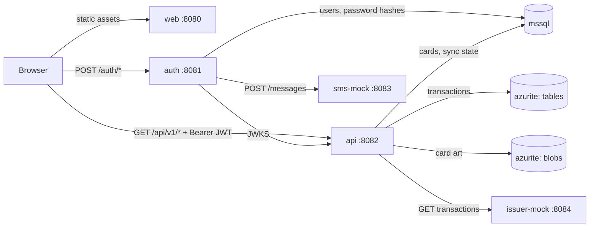
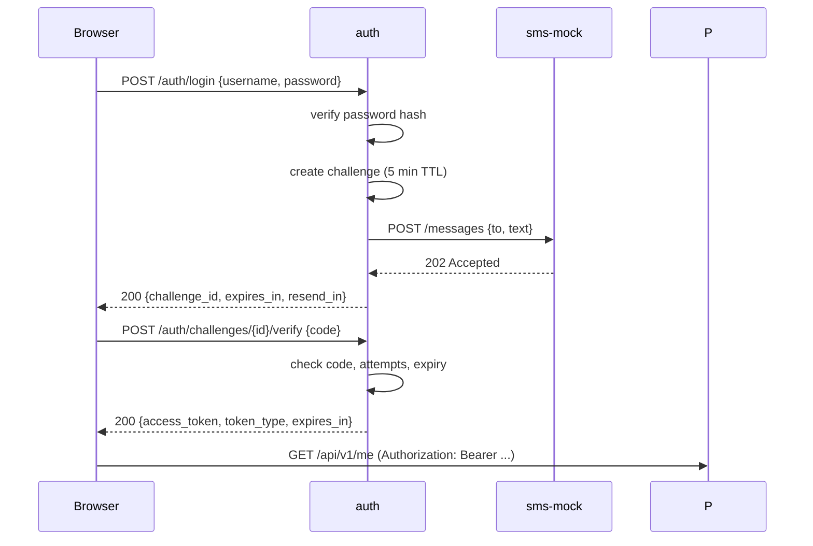

# SME Demo — System Requirements & Architecture

- **Status:** Draft v0.3
- **Owner:** Architecture
- **Last updated:** 2026-11-06
- **Changes in v0.3:** the transaction feed moved to Azure Table Storage via
  Azurite; Cosmos DB deferred behind the same port; licensing notes extracted
  to [`licensing.md`](licensing.md).
- **Changes in v0.2:** ASP.NET Core implementation stack, three-tier layering,
  MediatR/AutoMapper, MSSQL + Cosmos DB + Azure Storage, separate JWT issuer
  container, mock issuer integration.

## 1. Purpose

A demonstration system for a single small/medium business (`sme`) that shows a
card-wallet experience: sign in, see your profile, see your cards, tap a card to
see its transactions.

The system runs entirely offline in Docker on one machine. It is small, but the
boundaries are real: the token issuer is a separate service from the API, tokens
are signed asymmetrically, and the card issuer is an external HTTP dependency
behind an adapter, not a direct database call.

## 2. Goals

| ID | Goal |
|----|------|
| G1 | One command starts the whole demo and it works with no internet access. |
| G2 | Authentication is architecturally separate from the resource API (separate service, separate signing key). |
| G3 | The UI is mobile-first and English-only, and looks like a consumer wallet app (Google Wallet as the reference). |
| G4 | Every demo shortcut is explicit and switchable, so nothing silently becomes production behaviour. |
| G5 | The layering is conventional and boring: thin endpoints, logic in the application layer, data and third-party access in the infrastructure layer. |
| G6 | Swapping the mock issuer or mock SMS provider for a real one is an adapter change, not a rewrite. |

## 3. Non-goals

- Admin roles, user management, registration, password reset, profile editing.
- Multiple organisations or tenants. One deployment serves exactly one
  organisation, configured as `ORG_ID=sme`.
- Real card data. No PAN, no CVV, no real issuer connection. All card and
  transaction data is seeded fiction, produced by a mock issuer.
- Real SMS delivery, real payments, statements, disputes, spend limits.
- Token refresh, revocation lists, device management.
- Production hardening: TLS, WAF, HA, horizontal scaling, full observability
  stack, audit trail.
- Polyglot persistence for its own sake. Each store below has a stated job; if
  it has no job, it does not ship.

## 4. Users and roles

| Role | Count | Description |
|------|-------|-------------|
| Cardholder | 1 | The only account. Signs in, views own profile, cards, and transactions. |

There are no administrators. All users are peers; the demo has exactly one.

## 5. Architecture

### 5.1 Runtime components

| Component | Responsibility | Persistent state | Port |
|-----------|----------------|------------------|------|
| `web` | React SPA, mobile-first wallet UI. Static assets served by nginx. | none | 8080 |
| `auth` | Credential check, OTP challenge, JWT issuance, OIDC-style discovery and JWKS. | MSSQL `sme_auth`, signing keys volume | 8081 |
| `api` | Resource server. Verifies JWTs, serves profile, cards, transactions, card art. | MSSQL `sme_api`, Table + Blob storage | 8082 |
| `issuer-mock` | Stand-in card issuer. Serves card transactions over HTTP. | none (in-memory fixture) | 8084 |
| `sms-mock` | Stand-in SMS provider. Accepts a send request and logs it. | none | 8083 |
| `mssql` | SQL Server 2022. Hosts `sme_auth` and `sme_api`. | `mssql-data` volume | internal 1433 |
| `azurite` | Azure Storage emulator. Table for the transaction feed, blob container for card artwork. | `azurite-data` volume | internal 10000, 10002 |

Only `web`, `auth`, `api`, `sms-mock`, and `issuer-mock` publish host ports.
Database and storage containers are reachable only on the Compose network.

### 5.2 Runtime view



The browser never talks to a database, the issuer mock, or the SMS mock. `api`
fetches `auth`'s public keys over the Compose network and never holds a signing
key.

### 5.3 Trust boundaries

- `auth` is the only component that can mint a token.
- `api` trusts a token only after verifying its signature against `auth`'s
  JWKS, plus `iss`, `aud`, and `exp`.
- `org` in the token is checked against the configured `ORG_ID`; it is not on
  its own a permission to see data. Every query is additionally scoped by the
  token's `sub`.
- The issuer mock is untrusted input. Payloads are validated before storage;
  its failures degrade the feed, they do not corrupt the ledger.

### 5.4 Implementation stack

| Concern | Choice |
|---------|--------|
| Runtime | .NET 10 (LTS), C# 14 |
| API host | ASP.NET Core minimal APIs |
| Endpoint orchestration | MediatR (community/free version pinned — see §13.2) |
| Object mapping | AutoMapper (free version pinned — see §13.2) |
| Validation | FluentValidation (Apache-2.0, current stable) + a MediatR pipeline behaviour |
| Persistence (relational) | EF Core 10 + `Microsoft.EntityFrameworkCore.SqlServer` |
| Persistence (transaction feed) | `Azure.Data.Tables` against Azurite |
| Blob storage | `Azure.Storage.Blobs` |
| Outbound HTTP | `IHttpClientFactory` + `Microsoft.Extensions.Http.Resilience` |
| Authentication | `Microsoft.AspNetCore.Authentication.JwtBearer` |
| Token creation | `Microsoft.IdentityModel.JsonWebTokens` |
| Password hashing | `Microsoft.AspNetCore.Identity.PasswordHasher<T>` (PBKDF2) |
| OpenAPI | built-in `Microsoft.AspNetCore.OpenApi` |
| Errors | built-in `ProblemDetails` + `IExceptionHandler` |
| Health checks | `Microsoft.Extensions.Diagnostics.HealthChecks` |
| Logging | built-in `Microsoft.Extensions.Logging`, JSON console |

**Preference rule.** Microsoft packages come first for runtime, hosting,
authentication, data access, and outbound HTTP. A well-maintained OSS library is
acceptable when it is licence-clean and has no real first-party equivalent:
FluentValidation qualifies (Apache-2.0), as do MediatR and AutoMapper in their
last permissively-licensed versions (§13.2). Packages that duplicate a
first-party capability without adding much stay out: Serilog (built-in logging),
Swashbuckle (built-in OpenAPI), Dapper (EF Core), Mapster (AutoMapper),
MassTransit (not needed at this size).

### 5.5 Layering rules

Three tiers plus a domain project, all in one solution:

```
src/
  SmeDemo.Api/              presentation: endpoints, auth wiring, composition root
  SmeDemo.Application/      use cases: MediatR handlers, DTOs, profiles, port interfaces
  SmeDemo.Domain/           entities, value objects, domain errors
  SmeDemo.Infrastructure/   adapters: EF Core, Table Storage, Blob, issuer HTTP client
  SmeDemo.Auth/             independent JWT issuer service, own project and Dockerfile
tests/
  SmeDemo.Application.Tests/
  SmeDemo.Api.Tests/        integration through WebApplicationFactory
```

The rules that make "thin endpoints" mean something:

| Rule | Enforcement |
|------|-------------|
| An endpoint may only bind input, call `ISender.Send`, and map the result to HTTP. | Code review; the `Api` project has no reference to `Infrastructure`. |
| No `DbContext`, `TableClient`, `BlobClient`, or `HttpClient` in `Api`. | Project references make it impossible to compile. |
| No business rules in handlers that belong to entities. | Domain project owns invariants; handlers orchestrate. |
| Every third-party dependency is behind an interface declared in `Application`. | Adapters live in `Infrastructure` and are registered in the composition root. |
| Cross-cutting concerns are pipeline behaviours, not repeated code. | Logging, validation, and timing behaviours in `Application`. |

**Where validation lives.** Request shape — required fields, formats, ranges,
page sizes, 6-digit OTP codes — is enforced by FluentValidation validators in
`Application`, run by a pipeline behaviour before the handler. Business
invariants — a card belongs to the caller, an amount is positive, a status
transition is legal — stay in `Domain`. Validators never touch the database: a
check that needs a lookup is a business decision, and belongs in the handler
where it can also return the right error code.

Typical request path: endpoint → `ISender.Send(GetCardTransactionsQuery)` →
validation behaviour → handler → `ITransactionStore` / `ICardRepository` →
DTO mapped by AutoMapper → `Results.Ok` or a `ProblemDetails` result.

### 5.6 Container and resource footprint

Seven containers. Approximate steady-state memory:

| Container | Memory | Notes |
|-----------|--------|-------|
| `mssql` | ~2 GB | SQL Server 2022 Developer image. |
| `azurite` | ~250 MB | Blob and table endpoints. |
| `web` | ~50 MB | nginx + static assets. |
| `auth` | ~200 MB | |
| `api` | ~250 MB | |
| `issuer-mock` | ~150 MB | |
| `sms-mock` | ~150 MB | |
| **Total** | **~3 GB** | Docker Desktop memory of 4 GB is enough; 8 GB is comfortable. |

The MSSQL container dominates this. The Cosmos emulator was the real cost, and
dropping it is what keeps the demo runnable on an ordinary laptop (see §8.6).

## 6. Authentication

### 6.1 Flow



### 6.2 Endpoints (auth)

| Method | Path | Purpose |
|--------|------|---------|
| POST | `/auth/login` | Verify username/password, create MFA challenge, trigger SMS. |
| POST | `/auth/challenges/{challenge_id}/verify` | Verify OTP, return access token. |
| POST | `/auth/challenges/{challenge_id}/resend` | Re-send OTP, subject to cooldown. |
| GET | `/.well-known/openid-configuration` | Issuer metadata (`issuer`, `jwks_uri`). |
| GET | `/.well-known/jwks.json` | Public signing keys. |
| GET | `/healthz` | Liveness for Compose. |

The discovery document exists so the API can use the stock `JwtBearer` handler
with `MetadataAddress`, instead of hand-rolled validation code.

### 6.3 Challenge rules

| Rule | Value |
|------|-------|
| Challenge TTL | 5 minutes |
| Max verification attempts | 3, then the challenge is destroyed |
| Resend cooldown | 60 seconds |
| Challenge reuse | Single use; a successful verify invalidates it |
| Challenge storage | In-memory in `auth` (single instance, demo only) |

Codes and challenges are never logged in plaintext by the API or the UI.

### 6.4 Demo mode

`DEMO_MODE=true` makes the following true:

- The only accepted username, password, and phone number come from environment
  variables (`DEMO_USERNAME`, `DEMO_PASSWORD`, `DEMO_PHONE`).
- The OTP is the fixed value `DEMO_OTP` (default `123456`) instead of a random
  code.
- The login screen shows a clearly labelled demo hint with the credentials.

With `DEMO_MODE=false`, the fixed OTP path is refused at startup and a real
`ISmsProvider` must be configured. This prevents the fixed code from ever
becoming a back door.

### 6.5 SMS provider seam

`auth` depends on:

```
ISmsProvider.Send(phoneNumber, message, cancellationToken) -> providerMessageId
```

The only demo implementation posts to `SMS_PROVIDER_URL` (`sms-mock`). Replacing
it with Twilio, SNS, or an internal gateway means one adapter plus one
environment variable.

### 6.6 Token specification

- Format: JWT, **RS256**, 2048-bit RSA, `kid` in the header.
- Issuer metadata and JWKS are published by `auth`; keys are generated on first
  start and persisted in the `auth-keys` volume.

| Claim | Example | Notes |
|-------|---------|-------|
| `iss` | `http://auth:8081` | Must equal `JWT_ISSUER`. |
| `aud` | `sme-demo-api` | Must equal `JWT_AUDIENCE`. |
| `sub` | `7f3c...` | User ID. The only identifier used for data lookups. |
| `org` | `sme` | Organisation code. Must equal the API's `ORG_ID`. |
| `name` | `Alex Morgan` | Display convenience only. |
| `iat` / `exp` | — | TTL 30 minutes (`JWT_TTL`). |
| `jti` | UUID | Unique token ID, logged for traceability. |

Deliberate omissions:

- **No phone number in the token.** It is PII, it would end up in logs and
  browser storage, and the API can read it from the database anyway.
- **No roles or permissions.** With one peer-level user there is nothing to
  express; adding a role model now would be speculative.

Accepted limitations: no refresh token, no revocation.

### 6.7 Issuer implementation notes

- `auth` is a separate project (`SmeDemo.Auth`) with its own Dockerfile and its
  own database (`sme_auth`) on the shared MSSQL instance. It shares no domain
  code with `api`.
- Password hashes use `PasswordHasher<User>` (PBKDF2-HMAC-SHA256, per-user
  salt). Even the single demo account is stored hashed.
- The signing key is generated on first start, written to `/keys` on the
  `auth-keys` volume, and never committed.
- `api` configures `JwtBearer` with `MetadataAddress =
  http://auth:8081/.well-known/openid-configuration` and
  `RequireHttpsMetadata = false`. That flag is development-only and must be
  tied to configuration, not hard-coded.

## 7. Resource API

Base path `/api/v1`. JSON only. `Authorization: Bearer <jwt>` on every request
except `/healthz`.

| Method | Path | Purpose |
|--------|------|---------|
| GET | `/api/v1/me` | Profile: id, name, phone, org. |
| GET | `/api/v1/me/cards` | All cards for the caller, in display order. |
| GET | `/api/v1/me/cards/{card_id}/transactions` | Transactions for one card, newest first. |
| GET | `/api/v1/cards/{card_id}/art` | Card artwork, streamed from blob storage. |
| GET | `/healthz` | Liveness for Compose. |
| GET | `/openapi/v1.json` | OpenAPI document (Development only). |

### 7.1 Responses

- `GET /me` → `{ "id", "name", "phone", "org" }`.
- `GET /me/cards` → `{ "items": [ { "id", "brand", "last4", "expiry_month",
  "expiry_year", "status", "currency", "display_order", "art_url" } ] }`.
- Transactions → `{ "items": [ { "id", "card_id", "amount_minor", "currency",
  "direction", "merchant", "status", "occurred_at" } ], "next_cursor": "..." }`.

The UI never constructs storage URLs; `art_url` always points back at the API,
so blob credentials never reach the browser.

### 7.2 Errors

```json
{ "error": { "code": "TOKEN_EXPIRED", "message": "Access token has expired." } }
```

Validation failures additionally carry a per-field dictionary:

```json
{ "error": { "code": "VALIDATION_ERROR",
             "message": "One or more validation errors occurred.",
             "errors": { "code": ["The code must be 6 digits."] } } }
```

| Code | HTTP | When |
|------|------|------|
| `VALIDATION_ERROR` | 400 | Malformed body or query, or a validator rejected the request; details in `error.errors`. |
| `UNAUTHENTICATED` | 401 | Missing or unparseable bearer token. |
| `TOKEN_EXPIRED` | 401 | `exp` in the past. |
| `INVALID_TOKEN` | 401 | Signature, `iss`, or `aud` mismatch. |
| `FORBIDDEN` | 403 | Token valid but org mismatch or resource not owned. |
| `NOT_FOUND` | 404 | Unknown card ID. |
| `UPSTREAM_UNAVAILABLE` | 503 | A required store is unavailable after retries. |
| `RATE_LIMITED` | 429 | Too many OTP attempts or sends. |
| `INTERNAL` | 500 | Unhandled failure. |

### 7.3 Pagination

Cursor-based, `limit` default 20, maximum 100. The cursor is the store's row key,
base64url-wrapped, so the contract does not leak the storage layout and the
client never constructs one. `next_cursor` is `null` on the last page. No total
counts.

## 8. Data model

### 8.1 Store ownership

| Store | Owns | Why |
|-------|------|-----|
| MSSQL `sme_auth` | users, password hashes | Relational, transactional, written only by `auth`. |
| MSSQL `sme_api` | cards, issuer sync state | Small, relational, joined on demand. |
| Table `transactions` | the transaction feed | Append-only, per-card, ordered by row key. |
| Blob `card-art` | card artwork images | Binary assets, not queryable. |

There is no dual write. Each fact has exactly one home, and only `api` reads
more than one store.

### 8.2 `auth.users` (MSSQL `sme_auth`)

| Column | Type | Notes |
|--------|------|-------|
| `id` | uniqueidentifier, PK | Becomes `sub`. |
| `org_id` | nvarchar(32) | `sme`. |
| `username` | nvarchar(128), unique | Demo value from env. |
| `password_hash` | nvarchar(256) | PBKDF2, never plaintext. |
| `name` | nvarchar(128) | Display name. |
| `phone` | nvarchar(32) | E.164. MFA destination. |
| `status` | nvarchar(16) | `active` / `disabled`. |
| `created_at` | datetime2 | UTC. |

### 8.3 `app.cards` (MSSQL `sme_api`)

| Column | Type | Notes |
|--------|------|-------|
| `id` | uniqueidentifier, PK | |
| `user_id` | uniqueidentifier | Logical reference to `auth.users.id`; no cross-database FK. |
| `org_id` | nvarchar(32) | `sme`. |
| `brand` | nvarchar(32) | `visa`, `mastercard`. |
| `last4` | char(4) | **Only the last four digits are ever stored.** |
| `expiry_month` | tinyint | 1–12. |
| `expiry_year` | smallint | Four digits. |
| `status` | nvarchar(16) | `active`, `frozen`, `expired`. |
| `currency` | char(3) | ISO 4217, `AUD`. |
| `display_order` | smallint | Wallet ordering. |
| `art_blob_name` | nvarchar(128) | Blob name for the card artwork. |

### 8.4 `app.issuer_sync` (MSSQL `sme_api`)

| Column | Type | Notes |
|--------|------|-------|
| `card_id` | uniqueidentifier, PK | |
| `last_synced_at` | datetime2 | UTC. |
| `last_status` | nvarchar(16) | `ok` / `failed`. |
| `last_error` | nvarchar(512), null | Redacted message. |

This is the only table that records integration state, and it is what makes the
issuer dependency visible rather than implicit.

### 8.5 `transactions` (Table Storage)

One table, `transactions`. Table Storage has no secondary indexes and no
cross-partition ordering, so the key design carries the query:

| Key | Value | Why |
|-----|-------|-----|
| `PartitionKey` | card ID | Every read is scoped to one card. |
| `RowKey` | `{reverseTicks:D19}_{transactionId}` | Ascending order on a zero-padded reversed tick count equals newest-first; the ID breaks ties. |

`reverseTicks = DateTime.MaxValue.Ticks - occurredAt.UtcTicks`, formatted to 19
digits. A page is a range scan:

```
PartitionKey eq '{cardId}' and RowKey gt '{cursor}'
```

The cursor is the last returned `RowKey`, so pagination stays stable even when
new transactions arrive between requests.

Entity fields: `OrgId`, `TransactionId`, `AmountMinor`, `Currency`, `Direction`,
`Merchant`, `Status`, `OccurredAt`, `PostedAt`, `IssuerPayload` (string, the raw
issuer JSON), `IngestedAt`. Entities are upserted by `RowKey`, so re-syncing the
same transaction is idempotent.

Known limits, accepted because the feed only ever does one thing: no
cross-partition queries, no server-side aggregation, and 1 MB per entity. The
issuer payload must stay under that limit; at a few KB per transaction it does.

### 8.6 Transaction store abstraction

`Application` declares `ITransactionStore` with one read method (card, cursor,
limit) and one write method (upsert batch). The only adapter in this version is
`TableTransactionStore`.

Cosmos DB is deliberately **not** implemented. Nothing in this document needs a
document database: the feed is per-card, append-only, and small. A
`CosmosTransactionStore` can be added later without touching the application
layer, because the port already exists. The trigger is a real requirement —
multi-region reads, entities above 1 MB, rich querying, sustained write volume —
not the wish to have a document database in the diagram.

Cost note for that eventual decision: Cosmos DB bills by provisioned throughput
or request units, and a provisioned container has a floor that is billed
continuously even when idle. At demo volume (tens of rows, one user) that floor
is the entire bill. Table Storage bills per stored GB and per request, which
rounds to zero here.

### 8.7 Seed and sync

1. `auth` seeds one user (from env values) if the table is empty.
2. `api` seeds three cards and their artwork (uploaded to `card-art`) if empty.
3. `IssuerSyncService` (a hosted background service) calls the issuer for every
   card at startup and every 5 minutes, upserting results into the transaction
   store.
4. The UI therefore reads a warm, local feed and never waits on the issuer.

The mock issuer serves deterministic fixture data, so a reset always produces
the same demo.

## 9. Front-end

### 9.1 Stack

React 18 + TypeScript + Vite + React Router + Tailwind CSS, built to static
assets and served by nginx. This matches the production stack, so the demo UI is
disposable but not alien.

### 9.2 Routes

| Route | Screen | Notes |
|-------|--------|-------|
| `/login` | Sign-in | Username, password, then OTP step. Demo hint visible in demo mode. |
| `/wallet` | Card wallet | Grid of card tiles. Default route after sign-in. |
| `/wallet/cards/:cardId` | Card detail | Card summary plus its transactions. |
| `/profile` | Profile | Name, phone, organisation from `/me`. |

### 9.3 Wallet experience

- Cards render as rounded rectangles at roughly 1.586:1, in a responsive grid:
  one column at 360 px, two at 640 px, three at 1024 px, capped at a comfortable
  max width.
- Each tile shows brand, masked number (`•••• 4242`), expiry, and status.
- Tapping a tile navigates to that card's transactions; back returns to the
  wallet without losing scroll position.
- Visual tone: brand-coloured gradients, generous spacing, large tap targets
  (minimum 44 px), no dense tables.

### 9.4 Transactions screen

- Card summary at the top, then transactions newest first, grouped by date.
- Each row: merchant, time, signed amount (`−A$12.40` / `+A$5.00`), and a
  `Pending` badge when applicable.
- "Load more" using `next_cursor`. Empty state: "No transactions yet."

### 9.5 States

Every screen handles: loading (skeleton, not a spinner-only blank), empty,
request failure with retry, and expired session.

### 9.6 Session handling

- The token is held in `sessionStorage` and attached by a single fetch wrapper.
- Any `401` clears the token and redirects to `/login` with a short message.
- No silent refresh; expiry after 30 minutes returns the user to sign-in.

### 9.7 Localisation

English only, `en-AU` formatting: `A$` currency symbol, `DD MMM YYYY` dates.

## 10. Docker and runtime

### 10.1 Compose services

| Service | Image | Published | Healthcheck |
|---------|-------|-----------|-------------|
| `web` | multi-stage Node build → nginx | 8080 | `GET /` |
| `auth` | built from `src/SmeDemo.Auth` | 8081 | `GET /healthz` |
| `api` | built from `src/SmeDemo.Api` | 8082 | `GET /healthz` |
| `sms-mock` | built from `tools/SmsMock` | 8083 | `GET /healthz` |
| `issuer-mock` | built from `tools/IssuerMock` | 8084 | `GET /healthz` |
| `mssql` | `mcr.microsoft.com/mssql/server:2022-latest` | none | `sqlcmd SELECT 1` |
| `azurite` | `mcr.microsoft.com/azure-storage/azurite` | none | blob and table probes |

Startup ordering: `mssql` and `azurite` healthy → `auth` → `api`;
`api` also waits for `issuer-mock` and `sms-mock`.

### 10.2 Compose profiles

One profile: everything. There is no lite mode, because the only component that
justified one — the Cosmos emulator — is no longer in the stack.

If Cosmos is added later (§8.6), it arrives as an optional profile plus a second
`ITransactionStore` adapter, not as a change to the default path.

### 10.3 Configuration

| Variable | Used by | Default |
|----------|---------|---------|
| `ORG_ID` | auth, api | `sme` |
| `DEMO_MODE` | auth, web | `true` |
| `DEMO_USERNAME` / `DEMO_PASSWORD` / `DEMO_PHONE` | auth | demo values |
| `DEMO_OTP` | auth | `123456` |
| `JWT_ISSUER` / `JWT_AUDIENCE` / `JWT_TTL` | auth, api | `http://auth:8081`, `sme-demo-api`, `30m` |
| `JWKS_URL` / `AUTH_METADATA_URL` | api | `http://auth:8081/.well-known/...` |
| `SMS_PROVIDER_URL` | auth | `http://sms-mock:8083` |
| `ISSUER_BASE_URL` / `ISSUER_API_KEY` | api | `http://issuer-mock:8084`, fake key |
| `AZURE_STORAGE_CONNECTION_STRING` | api | `UseDevelopmentStorage=true` (blobs and tables) |
| `TRANSACTIONS_TABLE` | api | `transactions` |
| `DATABASE_URL` (auth/api) | auth, api | Compose-internal DSNs |
| `CORS_ORIGIN` | auth, api | `http://localhost:8080` |

Secrets live in `.env` (git-ignored, with `.env.example` committed). No secret
is baked into an image.

### 10.4 Start, seed, reset

- `docker compose up --build` builds and starts everything.
- Seed data is applied idempotently at start-up (one user, three cards, about
  40 transactions fetched from the mock issuer).
- `docker compose down -v && docker compose up` returns the demo to its initial
  state.

### 10.5 Offline behaviour

Images are pulled and NuGet/npm dependencies restored once during
`docker compose build`, when a network is available. After that the demo runs
with no outbound traffic: no external SMS, no CDN assets, no remote fonts.

## 11. Security posture

Implemented:

- Passwords hashed with PBKDF2 (ASP.NET Core Identity hasher), even for the one
  demo account.
- RS256 tokens, 30-minute TTL, signature and `iss`/`aud`/`exp` all validated.
- The fixed OTP is unreachable unless `DEMO_MODE=true`.
- CORS allowlist limited to the web origin.
- No PAN, CVV, or PIN anywhere in code, seed data, or logs.
- Card art served only through the API; storage credentials stay server-side.
- Phone numbers and tokens redacted from logs.

Accepted for the demo, listed so nobody mistakes them for production:

- Plain HTTP on localhost, no TLS.
- Token in `sessionStorage` rather than an httpOnly cookie.
- In-memory challenge store; an `auth` restart drops pending challenges.
- No revocation, no refresh token.
- Rate limiting is per-challenge, not per-IP.
- Storage uses the Azurite development account with its well-known key.
  Production would use managed identity or a scoped SAS instead of a connection
  string.

## 12. Verification and acceptance

The demo is done when all of these hold on a clean machine:

1. `docker compose up --build` brings all seven services healthy with no manual
   steps.
2. `http://localhost:8080` loads the sign-in screen on a 360 px viewport without
   horizontal scrolling.
3. Wrong password is rejected with a readable message; three wrong OTPs destroy
   the challenge.
4. Correct credentials plus the demo OTP land on the wallet with three cards,
   each showing its artwork.
5. Tapping a card shows that card's transactions, newest first, with correct
   signed amounts and currency.
6. "Load more" paginates without duplicates.
7. Refreshing the page keeps the session; expiry or cleared storage returns to
   sign-in.
8. `/profile` shows the name, phone, and organisation from the API, not from the
   token.
9. Signing out clears the session and returns to `/login`.
10. With the network disconnected after build, the demo still passes steps 2–9.
11. Stopping `issuer-mock` leaves the wallet usable and logs a handled upstream
    failure; it does not return 500 to the browser.
12. `docker compose down -v && docker compose up` restores the identical demo,
    including the same seeded transactions.

## 13. Risks and decisions

### 13.1 Why Cosmos DB was dropped

The honest reason is that we could not say what it would hold. The candidate
workload — a per-card transaction feed — is small, append-only, and queried one
way, which Table Storage serves exactly, for pennies, from a container we
already run. Cosmos would have added a 2–4 GB emulator, a certificate bypass, an
x64-only image, and a minute-long start-up, in exchange for capabilities (global
distribution, elastic throughput, rich queries) that this demo never exercises.

It is deferred, not rejected: `ITransactionStore` is the seam, and §8.6 lists
the requirements that would justify adding it.

### 13.2 MediatR and AutoMapper are no longer free for every organisation

Both moved to a dual RPL-1.5 / commercial model under Lucky Penny Software.
MediatR 13+ and AutoMapper 15+ require either a commercial licence or the free
Community edition, which is limited to organisations under US$5M gross annual
revenue (and, for MediatR, under US$10M in outside capital) and requires
registering a licence key.

For a demo, the cheapest and least risky option is to pin the last
permissively-licensed versions (MediatR 12.x, AutoMapper 14.x) and record that
pin in `Directory.Packages.props`. The reasoning, the exact licence texts, and
what management needs to sign off are in [`licensing.md`](licensing.md).

FluentValidation is Apache-2.0 and unaffected by any of this; it needs no
licensing decision.

### 13.3 MSSQL dominates the footprint

Total footprint is roughly 3 GB, almost all of it SQL Server. That is fine on a
16 GB laptop and tight but workable on 8 GB. Do not promise "it runs anywhere"
without measuring on the actual demo hardware.

### 13.4 Mock issuer determinism

The mock returns fixed fixtures keyed by card ID. If the fixtures ever change,
the acceptance screenshots change too. Treat the fixture file as part of the
demo contract.

## 14. Open questions

1. **Licensing:** confirm the pinning approach in `licensing.md` with management.
   Default in this document: pin the permissive versions, no licence key.
2. **Cosmos DB:** does anything else in the roadmap need it? If not, the port
   stays unused and that is the correct outcome.
3. **Real IdP:** is Auth0, Entra, or Cognito expected later? If so, `auth` will
   be replaced rather than extended — which is fine, but it changes how much
   credential logic is worth writing.
4. **SMS provider:** which one, so the adapter can be written against its shape
   when the time comes.
5. **Projector or phone:** which layout is rehearsed as the primary target.
