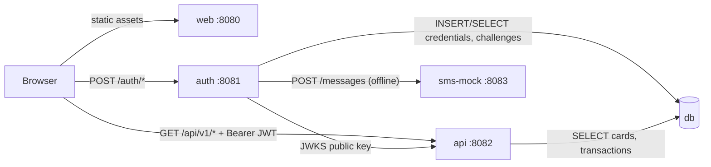
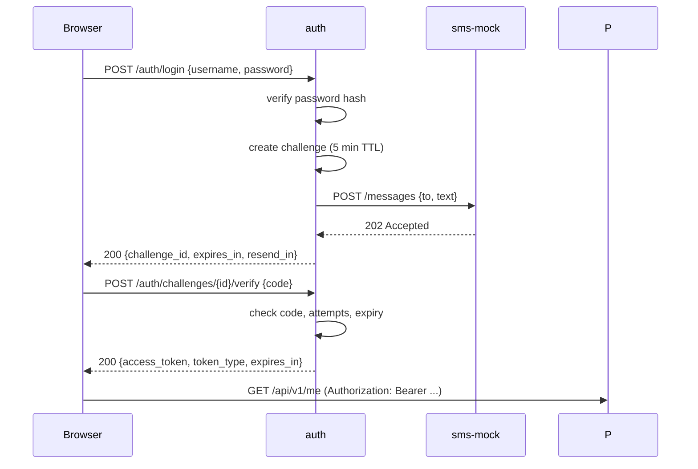

# SME Demo — System Requirements & Architecture

- **Status:** Draft v0.1
- **Owner:** Architecture
- **Last updated:** 2026-11-06

## 1. Purpose

A demonstration system for a single small/medium business (`sme`) that shows a
card-wallet experience: sign in, see your profile, see your cards, tap a card to
see its transactions.

The system has four runtime components: a web UI, an independent JWT issuer
(auth), a resource API, and a database. Everything runs offline in Docker on one
machine.

The demo is intentionally small, but the boundaries are real: the token issuer
is a separate service from the API, tokens are signed asymmetrically, and the
SMS provider is behind an interface so it can be swapped for a real one without
touching business logic.

## 2. Goals

| ID | Goal |
|----|------|
| G1 | One command starts the whole demo and it works with no internet access. |
| G2 | Authentication is architecturally separate from the resource API (separate service, separate signing key). |
| G3 | The UI is mobile-first and English-only, and looks like a consumer wallet app (Google Wallet as the reference). |
| G4 | Every demo shortcut is explicit and switchable, so nothing silently becomes production behaviour. |
| G5 | Replacing the mock SMS provider with a real one is a configuration change, not a code change. |

## 3. Non-goals

Explicitly out of scope for this demo:

- Admin roles, user management, registration, password reset, profile editing.
- Multiple organisations or tenants. One deployment serves exactly one
  organisation, configured as `ORG_ID=sme`.
- Real card data. No PAN, no CVV, no expiry validation against a scheme. All
  card and transaction data is seeded fiction.
- Real SMS delivery, real payments, statements, disputes, spend limits.
- Token refresh, revocation lists, device management.
- Production hardening: TLS, WAF, HA, horizontal scaling, full observability
  stack, audit trail.

## 4. Users and roles

| Role | Count | Description |
|------|-------|-------------|
| Cardholder | 1 | The only account. Signs in, views own profile, cards, and transactions. |

There are no administrators. All users are peers; the demo has exactly one.

## 5. Architecture

### 5.1 Components

| Component | Responsibility | Owns | Port |
|-----------|----------------|------|------|
| `web` | React SPA, mobile-first wallet UI. Serves static assets via nginx. | Nothing persistent | 8080 |
| `auth` | Credential check, OTP challenge, JWT issuance, JWKS publication. | `auth` schema | 8081 |
| `api` | Resource server. Verifies JWTs, serves profile/cards/transactions. | `app` schema | 8082 |
| `sms-mock` | Stand-in SMS provider. Accepts a send request and logs it. | Nothing | 8083 |
| `db` | PostgreSQL 16. | Both schemas | internal 5432 |

Only `web`, `auth`, `api`, and `sms-mock` publish host ports. `db` is reachable
only on the Compose network.

### 5.2 Runtime view



The browser never talks to `db` or `sms-mock`. `api` fetches the public key from
`auth` over the Compose network; it never holds a signing key.

### 5.3 Trust boundaries

- `auth` is the only component that can mint a token.
- `api` trusts a token only after verifying its signature against `auth`'s
  JWKS, plus `iss`, `aud`, and `exp`.
- `org` in the token is checked against the configured `ORG_ID`; it is not on
  its own a permission to see data. Every query is additionally scoped by the
  token's `sub`.

## 6. Authentication

### 6.1 Flow



### 6.2 Endpoints (auth)

| Method | Path | Purpose |
|--------|------|---------|
| POST | `/auth/login` | Verify username/password, create MFA challenge, trigger SMS. |
| POST | `/auth/challenges/{challenge_id}/verify` | Verify OTP, return access token. |
| POST | `/auth/challenges/{challenge_id}/resend` | Re-send OTP, subject to cooldown. |
| GET | `/.well-known/jwks.json` | Public signing keys. |
| GET | `/healthz` | Liveness for Compose. |

### 6.3 Challenge rules

| Rule | Value |
|------|-------|
| Challenge TTL | 5 minutes |
| Max verification attempts | 3, then the challenge is destroyed |
| Resend cooldown | 60 seconds |
| Challenge reuse | Single use; a successful verify invalidates it |
| Challenge storage | In-memory in `auth` (single instance, demo only) |

Codes and challenges are never logged in plaintext by the API or the UI.

### 6.4 Demo mode

`DEMO_MODE=true` makes the following true:

- The only accepted username, password, and phone number come from environment
  variables (`DEMO_USERNAME`, `DEMO_PASSWORD`, `DEMO_PHONE`).
- The OTP is the fixed value `DEMO_OTP` (default `123456`) instead of a random
  code.
- The login screen shows a clearly labelled demo hint with the credentials.

With `DEMO_MODE=false`, the fixed OTP path is refused at startup unless a real
`SmsProvider` is configured. This prevents the fixed code from ever becoming a
back door.

### 6.5 SMS provider seam

`auth` depends on an interface:

```
send(phoneNumber, message) -> providerMessageId
```

The only implementation in the demo is an HTTP adapter that posts to
`SMS_PROVIDER_URL` (`sms-mock`). Swapping in Twilio, SNS, or an internal
gateway means adding one adapter and changing one environment variable. No
business logic changes.

### 6.6 Token specification

- Format: JWT, **RS256**, 2048-bit RSA.
- Header carries `kid`; `auth` publishes the matching public keys at
  `/.well-known/jwks.json`.
- Keys are generated on first start and persisted in the `auth-keys` volume, so
  restarts do not invalidate the demo.

| Claim | Example | Notes |
|-------|---------|-------|
| `iss` | `http://auth:8081` | Must equal `JWT_ISSUER` on the API side. |
| `aud` | `sme-demo-api` | Must equal `JWT_AUDIENCE`. |
| `sub` | `7f3c...` | User ID. The only identifier used for data lookups. |
| `org` | `sme` | Organisation code. Must equal the API's `ORG_ID`. |
| `name` | `Alex Morgan` | Display convenience only. |
| `iat` / `exp` | — | TTL 30 minutes (`JWT_TTL`). |
| `jti` | UUID | Unique token ID, logged for traceability. |

Deliberate omissions:

- **No phone number in the token.** It is PII, it would end up in logs and
  browser storage, and the API can read it from the database anyway.
- **No roles or permissions.** With one peer-level user there is nothing to
  express; adding a role model now would be speculative.

Accepted demo limitations: no refresh token (the user signs in again after 30
minutes), no revocation (a stolen token is valid until `exp`).

## 7. Resource API

Base path `/api/v1`. JSON only. `Authorization: Bearer <jwt>` on every request
except `/healthz`.

| Method | Path | Purpose |
|--------|------|---------|
| GET | `/api/v1/me` | Profile: id, name, phone, org. |
| GET | `/api/v1/me/cards` | All cards for the caller, in display order. |
| GET | `/api/v1/me/cards/{card_id}/transactions` | Transactions for one card, newest first. |
| GET | `/healthz` | Liveness for Compose. |

### 7.1 Responses

- `GET /me` → `{ "id", "name", "phone", "org" }`.
- `GET /me/cards` → `{ "items": [ { "id", "brand", "last4", "expiry_month",
  "expiry_year", "status", "currency", "display_order" } ] }`.
- Transactions → `{ "items": [ { "id", "card_id", "amount_minor", "currency",
  "direction", "merchant", "status", "occurred_at" } ], "next_cursor": "..." }`.

### 7.2 Errors

```json
{ "error": { "code": "TOKEN_EXPIRED", "message": "Access token has expired." } }
```

| Code | HTTP | When |
|------|------|------|
| `VALIDATION_ERROR` | 400 | Malformed body or query. |
| `UNAUTHENTICATED` | 401 | Missing or unparseable bearer token. |
| `TOKEN_EXPIRED` | 401 | `exp` in the past. |
| `INVALID_TOKEN` | 401 | Signature, `iss`, or `aud` mismatch. |
| `FORBIDDEN` | 403 | Token valid but org mismatch or resource not owned. |
| `NOT_FOUND` | 404 | Unknown card ID. |
| `RATE_LIMITED` | 429 | Too many OTP attempts or sends. |
| `INTERNAL` | 500 | Unhandled failure. |

### 7.3 Pagination

Cursor-based, `limit` default 20, maximum 100. The cursor is an opaque,
base64-encoded `(occurred_at, id)` pair. `next_cursor` is `null` on the last
page. No total counts.

## 8. Data model

One PostgreSQL database, two schemas, one owner per schema. Each service runs
its own idempotent migrations at start-up; neither reads the other's tables.

### 8.1 `auth.users`

| Column | Type | Notes |
|--------|------|-------|
| `id` | uuid, PK | Becomes `sub`. |
| `org_id` | text | `sme`. |
| `username` | citext, unique | Demo value from env. |
| `password_hash` | text | Argon2id or bcrypt. Never plaintext, even in demo. |
| `name` | text | Display name. |
| `phone` | text, E.164 | MFA destination. |
| `status` | text | `active` / `disabled`. |
| `created_at` | timestamptz | UTC. |

### 8.2 `app.cards`

| Column | Type | Notes |
|--------|------|-------|
| `id` | uuid, PK | |
| `user_id` | uuid | FK to `auth.users.id`, logical only (no cross-schema FK). |
| `org_id` | text | `sme`. |
| `brand` | text | `visa`, `mastercard`. |
| `last4` | char(4) | **Only the last four digits are ever stored.** |
| `expiry_month` | smallint | 1–12. |
| `expiry_year` | smallint | Four digits. |
| `status` | text | `active`, `frozen`, `expired`. |
| `currency` | char(3) | ISO 4217, `AUD`. |
| `display_order` | smallint | Wallet ordering. |

### 8.3 `app.transactions`

| Column | Type | Notes |
|--------|------|-------|
| `id` | uuid, PK | |
| `card_id` | uuid | FK to `app.cards.id`. |
| `org_id` | text | `sme`. |
| `amount_minor` | bigint | Positive; currency minor units (cents). |
| `currency` | char(3) | ISO 4217. |
| `direction` | text | `debit` (money out) or `credit` (refund in). |
| `merchant` | text | Display string. |
| `status` | text | `posted` or `pending`. |
| `occurred_at` | timestamptz | UTC; the sort key. |

Indexes: `cards(user_id, display_order)`;
`transactions(card_id, occurred_at DESC, id DESC)`.

Invariants: amounts are integers (never floats); all timestamps are UTC; no
column can hold a full card number, CVV, or PIN.

## 9. Front-end

### 9.1 Stack

React 18 + TypeScript + Vite + React Router + Tailwind CSS, built to static
assets and served by nginx. This matches the production stack, so the demo UI is
disposable but not alien.

### 9.2 Routes

| Route | Screen | Notes |
|-------|--------|-------|
| `/login` | Sign-in | Username, password, then OTP step. Demo hint visible in demo mode. |
| `/wallet` | Card wallet | Grid of card tiles. Default route after sign-in. |
| `/wallet/cards/:cardId` | Card detail | Card summary plus its transactions. |
| `/profile` | Profile | Name, phone, organisation from `/me`. |

### 9.3 Wallet experience

- Cards render as rounded rectangles at roughly 1.586:1, in a responsive grid:
  one column at 360 px, two at 640 px, three at 1024 px, capped at a comfortable
  max width.
- Each tile shows brand, masked number (`•••• 4242`), expiry, and status.
- Tapping a tile navigates to that card's transactions; back returns to the
  wallet without losing scroll position.
- Visual tone: brand-coloured gradients, generous spacing, large tap targets
  (minimum 44 px), no dense tables.

### 9.4 Transactions screen

- Card summary at the top, then transactions newest first, grouped by date.
- Each row: merchant, time, signed amount (`−A$12.40` / `+A$5.00`), and a
  `Pending` badge when applicable.
- "Load more" button using `next_cursor`. Empty state: "No transactions yet."

### 9.5 States

Every screen handles: loading (skeleton, not a spinner-only blank), empty,
request failure with retry, and expired session.

### 9.6 Session handling

- The token is held in `sessionStorage` and attached by a single fetch wrapper.
- Any `401` clears the token and redirects to `/login` with a short message.
- No silent refresh; expiry after 30 minutes returns the user to sign-in.
- `sessionStorage` (rather than `localStorage`) limits persistence to the tab.

### 9.7 Localisation

English only, `en-AU` formatting: `A$` currency symbol, `DD MMM YYYY` dates,
24-hour times where space is tight.

## 10. Docker and runtime

### 10.1 Compose services

| Service | Build | Published | Healthcheck |
|---------|-------|-----------|-------------|
| `web` | multi-stage Node build → nginx | 8080 | `GET /` |
| `auth` | service image | 8081 | `GET /healthz` |
| `api` | service image | 8082 | `GET /healthz` |
| `sms-mock` | small service image | 8083 | `GET /healthz` |
| `db` | `postgres:16-alpine` | none | `pg_isready` |

`auth` and `api` wait for `db` to be healthy; `api` waits for `auth` to be
healthy. Volumes: `db-data`, `auth-keys`. One bridge network; no host
networking.

### 10.2 Configuration

| Variable | Used by | Default |
|----------|---------|---------|
| `ORG_ID` | auth, api | `sme` |
| `DEMO_MODE` | auth, web | `true` |
| `DEMO_USERNAME` / `DEMO_PASSWORD` / `DEMO_PHONE` | auth | demo values |
| `DEMO_OTP` | auth | `123456` |
| `JWT_ISSUER` / `JWT_AUDIENCE` / `JWT_TTL` | auth, api | `http://auth:8081`, `sme-demo-api`, `30m` |
| `JWKS_URL` | api | `http://auth:8081/.well-known/jwks.json` |
| `SMS_PROVIDER_URL` | auth | `http://sms-mock:8083` |
| `DATABASE_URL` | auth, api | Compose-internal DSN |
| `CORS_ORIGIN` | auth, api | `http://localhost:8080` |

Secrets live in `.env` (git-ignored, with `.env.example` committed). No secret
is baked into an image.

### 10.3 Start, seed, reset

- `docker compose up --build` builds and starts everything.
- Seed data is applied idempotently at start-up: one user, three cards, roughly
  40 transactions across them.
- `docker compose down -v && docker compose up` returns the demo to its initial
  state.

### 10.4 Offline behaviour

Images are pulled and npm/pip dependencies installed once during
`docker compose build`, when a network is available. After that the demo runs
with no outbound traffic: no external SMS, no CDN assets, no web fonts fetched
remotely. This is an acceptance criterion, not a preference.

## 11. Security posture

Implemented:

- Passwords hashed (Argon2id or bcrypt), even for the single demo account.
- RS256 tokens, short TTL, signature and `iss`/`aud`/`exp` all validated.
- The fixed OTP is unreachable unless `DEMO_MODE=true`.
- CORS allowlist limited to the web origin.
- No PAN, CVV, or PIN anywhere in code, seed data, or logs.
- Phone numbers and tokens redacted from logs.

Accepted for the demo, listed so nobody mistakes them for production:

- Plain HTTP on localhost, no TLS.
- Token in `sessionStorage` rather than an httpOnly cookie.
- In-memory challenge store; an `auth` restart drops pending challenges.
- No revocation, no refresh token.
- Rate limiting is per-challenge, not per-IP.

## 12. Acceptance criteria

The demo is done when all of these hold on a clean machine:

1. `docker compose up --build` brings all services healthy with no manual steps.
2. `http://localhost:8080` loads the sign-in screen on a 360 px viewport without
   horizontal scrolling.
3. Wrong password is rejected with a readable message; three wrong OTPs destroy
   the challenge.
4. Correct credentials plus the demo OTP land on the wallet with three cards.
5. Tapping a card shows that card's transactions, newest first, with correct
   signed amounts and currency.
6. Scrolling and "Load more" paginate without duplicates.
7. Refreshing the page keeps the session; waiting out the token or clearing
   storage returns to sign-in.
8. `/profile` shows the name, phone, and organisation from the API, not from
   the token.
9. Signing out clears the session and returns to `/login`.
10. With the network disconnected after build, the demo still passes steps 2–9.

## 13. Open questions

1. Which SMS provider will production use? It only affects the adapter, but it
   may add sender-ID or template constraints.
2. Will the demo be shown on a projector or on a phone? This decides whether the
   360 px layout or the desktop layout is the primary rehearsal target.
3. Is a real IdP (Auth0, Entra, Cognito) expected later? If so, `auth` may be
   replaced rather than extended, which is fine but should be decided before
   anyone builds credential storage beyond the demo.
